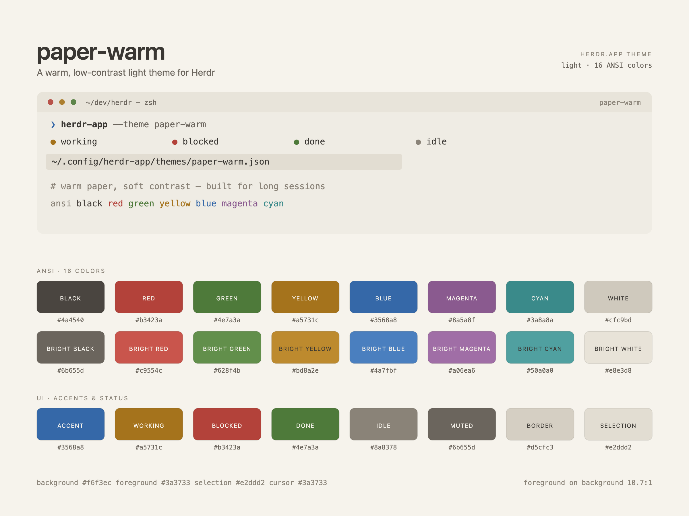

# Warm Rain

One warm, low-contrast light palette, packaged for four places: **Herdr**,
**VS Code**, **T3 Code**, and **Tabby**.

Warm paper instead of bright white, soft dark-brown text, and accents pulled a
step toward the page. Built for long sessions: lower glare, calmer surface, no
pure-white panels.



## Palette

| Role | Color |
| --- | --- |
| background / canvas | `#f6f3ec` |
| foreground / text | `#3a3733` |
| surface | `#efece4` |
| raised | `#e8e4da` |
| selection / hover | `#e2ddd2` |
| border | `#d5cfc3` |
| input | `#c3bcae` |
| muted | `#6b655d` |
| dim / placeholder | `#8a8378` |
| accent | `#3568a8` |
| error | `#b3423a` |
| warning / working | `#a5731c` |
| string / done | `#4e7a3a` |
| keyword | `#8a5a8f` |
| type / update | `#3a8a8a` |

The full 16-color ANSI set and the per-target UI color maps live in each
target's theme file.

## Targets

| Target | Folder | Install |
| --- | --- | --- |
| **Herdr** | [`herdr/`](herdr/) | Copy `herdr/themes/paper-warm.json` into `~/.config/herdr-app/themes/` |
| **VS Code** | [`vscode/`](vscode/) | Copy `vscode/` into `~/.vscode/extensions/therainisme.warmrain-0.1.0` |
| **T3 Code** | [`t3code/`](t3code/) | Import the VS Code theme JSON, or publish `t3code/warmrain.json` |
| **Tabby** | [`tabby/`](tabby/) | Merge `tabby/warmrain.yml` into Tabby's `config.yaml` |

Each target folder has its own README with the exact steps for that app.

## Repository layout

```
herdr/     Herdr theme (paper-warm.json) + preview and build recipe
vscode/    VS Code color theme extension
t3code/    T3 Code palette theme (version 1)
tabby/     Tabby TerminalColorScheme block for config.yaml
LICENSE    MIT
```

## Design notes

The low contrast is deliberate. Foreground on background is about **10.7:1**,
but `white` and `bright white` sit near the background on purpose — they are
tones for rules and fills, not body text. Do not "fix" the palette to reach
WCAG AA; that breaks what the theme is for.

The family was ported from the Herdr `paper-warm` theme, and all four targets
share the same canvas, text, accent, and ANSI colors.

## License

MIT — see [LICENSE](LICENSE).
