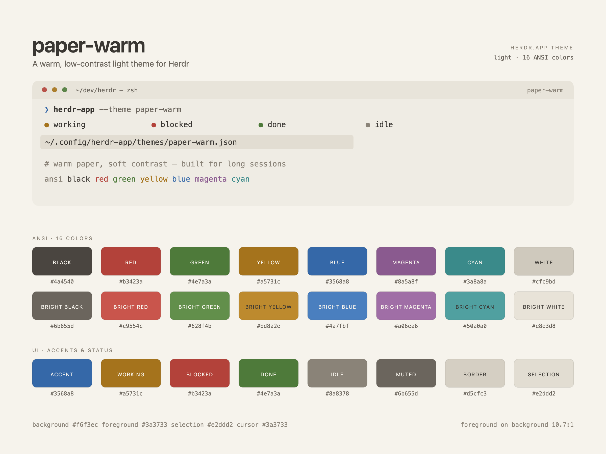

# paper-warm for Herdr

A low-contrast, warm light theme for [Herdr](https://herdr.dev) — soft paper instead of
bright white, with muted ANSI colors for long sessions. Part of the
[Warm Rain collection](../README.md), which ships the same palette for Herdr,
VS Code, and T3 Code.



## What it is

`paper-warm` is a single Herdr theme file: `themes/paper-warm.json`. It defines the
terminal background, foreground, selection and cursor, the 16 ANSI colors, and the
panel and status colors Herdr uses around the terminal.

It is a **light theme**. Herdr names a theme after its file, so keep the file name
`paper-warm.json`.

## Why this palette

Most light terminal themes are built on white (`#ffffff`) with saturated accents.
That is crisp, but after hours of reading it can feel glaring. `paper-warm` starts
from warm paper (`#f6f3ec`), keeps text at a soft dark brown (`#3a3733`), and pulls
every ANSI color a step toward the page.

The palette was made for long terminal sessions. A warm, lower-contrast surface
reduces glare and keeps the page calm over hours, where a pure-white, high-contrast
terminal can feel harsh.

Concretely (WCAG relative-luminance ratio):

- foreground on background: **10.7:1**
- normal ANSI colors: **3.7–8.6:1** (white is a near-background tone, see below)
- bright ANSI colors: **1.2–5.2:1**, intentionally softer than the normal set

This is a comfort palette, not an accessibility-maximizing one. If you need body
text at 7:1 or higher, this theme is not for you. The low-contrast direction is the
whole point. Herdr's own `minimum_contrast` setting can raise text contrast on top
of the theme if you want a more readable variant.

## Install

Copy the theme into Herdr's themes folder, then pick it in Settings.

```sh
mkdir -p ~/.config/herdr-app/themes
cp herdr/themes/paper-warm.json ~/.config/herdr-app/themes/
```

Run that from the repository root (macOS and Linux use the same path). Herdr
picks up new theme files automatically — no restart needed.

Then open **Settings → Look** and choose **paper-warm** from the theme picker.
To have it follow the system's light appearance, pick it as the light half of your
appearance pair.

## Uninstall

1. In **Settings → Look**, switch to another theme first.
2. Delete the file:

```sh
rm ~/.config/herdr-app/themes/paper-warm.json
```

The theme adds nothing else — no fonts, mods, layouts or settings.

## Palette

### Terminal

| Key | Hex | |
| --- | --- | --- |
| background | `#f6f3ec` | warm paper |
| foreground | `#3a3733` | soft dark brown |
| selection | `#e2ddd2` | pale warm gray |
| cursor | `#3a3733` | same as foreground |

### ANSI

| # | Name | Hex | # | Name | Hex |
| --- | --- | --- | --- | --- | --- |
| 0 | black | `#4a4540` | 8 | bright black | `#6b655d` |
| 1 | red | `#b3423a` | 9 | bright red | `#c9554c` |
| 2 | green | `#4e7a3a` | 10 | bright green | `#628f4b` |
| 3 | yellow | `#a5731c` | 11 | bright yellow | `#bd8a2e` |
| 4 | blue | `#3568a8` | 12 | bright blue | `#4a7fbf` |
| 5 | magenta | `#8a5a8f` | 13 | bright magenta | `#a06ea6` |
| 6 | cyan | `#3a8a8a` | 14 | bright cyan | `#50a0a0` |
| 7 | white | `#cfc9bd` | 15 | bright white | `#e8e3d8` |

`white` and `bright white` sit close to the background by design: in a light theme
they read as subtle tones for rules and backgrounds, not as body text.

### UI colors

| Key | Hex | Role |
| --- | --- | --- |
| canvas, chrome, surface, popover | `#efece4` | panels and window chrome |
| raised | `#e8e4da` | title bars, raised controls |
| hover, selected, selection | `#e2ddd2` | hover and selection fills |
| border | `#d5cfc3` | borders and dividers |
| input | `#c3bcae` | input outlines |
| muted | `#6b655d` | secondary text |
| dim | `#8a8378` | tertiary text |
| accent, solid | `#3568a8` | accent and filled controls |
| accent_foreground, solid_foreground | `#f6f3ec` | text on accent / solid |
| working | `#a5731c` | agent working |
| blocked | `#b3423a` | agent blocked |
| done | `#4e7a3a` | agent done |
| idle, unknown | `#8a8378` | agent idle / unknown |

## Files

```
themes/paper-warm.json   the theme itself
preview.svg              source of the preview image
preview.png              palette preview used at the top of this README
RECIPE.md                a build brief for reproducing the theme from scratch
../LICENSE               MIT
```

## License

MIT — see [LICENSE](../LICENSE).
