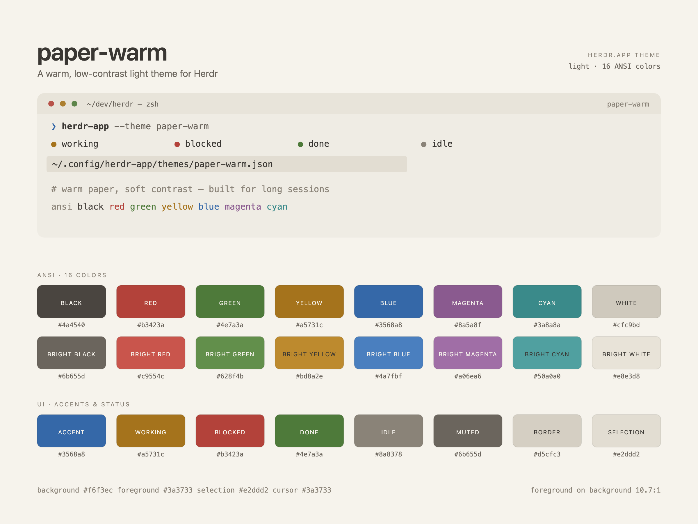

# paper-warm

A light theme for Herdr: warm paper background, soft dark-brown text, and 16 ANSI
colors pulled toward the page. One JSON file, no mods. The files in this folder are
one build of this recipe.

**What you see:** A light terminal. The window and terminal background is warm paper
`#f6f3ec`; body text is `#3a3733`; selections and hover fills are pale warm gray
`#e2ddd2`; the cursor is `#3a3733` — the same color as text, so it reads as a block
rather than a separate accent. Panels around the terminal (`canvas`, `chrome`,
`surface`, `popover`) are one step darker at `#efece4`; raised surfaces (title bars,
raised controls) are `#e8e4da`; borders are `#d5cfc3`; input outlines are `#c3bcae`.
The accent is muted blue `#3568a8`, with `#f6f3ec` text on top. Agent status colors
are amber `#a5731c` working, red `#b3423a` blocked, green `#4e7a3a` done, gray
`#8a8378` idle/unknown. The 16 ANSI colors are listed in Built from; none are
saturated, and white/bright white sit close to the background.

**How it behaves:** Selecting the theme in Settings → Look repaints the window,
terminals and panels immediately; there is no animation. It is light-only: use it as
the light theme, or select it directly. The selection color fills selected terminal
text and selected panels; hover uses the same `#e2ddd2`. Status dots and labels in
Herdr's UI use `working`/`blocked`/`done`/`idle`/`unknown`. Herdr's
`minimum_contrast` setting, if raised above `1`, may override individual text colors
on screen — the theme file itself is unchanged.

**Built from:** `themes/paper-warm.json`, parsed by Herdr as a theme object:
top-level `background`, `foreground`, `selection`, `cursor`, `ansi` (exactly 16
`#rrggbb` strings, normal colors 0–7 then bright 8–15), and an optional `colors`
object overriding derived panel colors. All values are lowercase `#rrggbb`. The
exact values:

- Top level: background `#f6f3ec`, foreground `#3a3733`, selection `#e2ddd2`,
  cursor `#3a3733`.
- ANSI normal: `#4a4540`, `#b3423a`, `#4e7a3a`, `#a5731c`, `#3568a8`, `#8a5a8f`,
  `#3a8a8a`, `#cfc9bd`.
- ANSI bright: `#6b655d`, `#c9554c`, `#628f4b`, `#bd8a2e`, `#4a7fbf`, `#a06ea6`,
  `#50a0a0`, `#e8e3d8`.
- `colors`: `background` `#f6f3ec`, `foreground` `#3a3733`, `canvas` `#efece4`,
  `chrome` `#efece4`, `surface` `#efece4`, `popover` `#efece4`, `raised` `#e8e4da`,
  `hover` `#e2ddd2`, `selected` `#e2ddd2`, `border` `#d5cfc3`, `input` `#c3bcae`,
  `muted` `#6b655d`, `dim` `#8a8378`, `accent` `#3568a8`,
  `accent_foreground` `#f6f3ec`, `solid` `#3568a8`, `solid_foreground` `#f6f3ec`,
  `selection` `#e2ddd2`, `working` `#a5731c`, `blocked` `#b3423a`, `done` `#4e7a3a`,
  `idle` `#8a8378`, `unknown` `#8a8378`.

Derivation rules worth keeping if you change a value: each ANSI hue should stay
recognizable but sit between roughly 3.7:1 and 8.6:1 against the background (white
excepted, see Watch out); the bright set is lighter versions of the same hues, so
bright colors have lower contrast, not higher. `background` and `foreground` in `colors` repeat the top-level
values; `selection` repeats in all three places; `accent` and `solid` are the same;
`accent_foreground` and `solid_foreground` are the background color. `muted` equals
ANSI bright black and `dim` equals `idle`/`unknown`. Keep the theme file name
`paper-warm.json`: Herdr uses the file name as the theme name.

Build `preview.png` as a palette board, not a screenshot of an editor: warm
background, the theme name, a small terminal mock showing foreground, selection,
status colors and a few ANSI words, then the 16 ANSI chips in two rows of eight with
name and hex, then the UI accent/status chips, all on `#f6f3ec`. Render it at 2×
(1200×900 logical) for a crisp README image.

**Watch out:** The low contrast is deliberate — do not "fix" it to reach WCAG AA;
that breaks the point of the theme. In particular `white` `#cfc9bd` (1.5:1) and
`bright white` `#e8e3d8` (1.2:1) are near-background tones, not reading colors;
bright yellow (2.8:1) and bright cyan (2.8:1) are accents, not body text. The `ansi`
array must have exactly 16 entries, and every value must be a 6-digit lowercase hex
color or Herdr will not load the file. `colors` is optional, but without it Herdr
derives panel colors from the four top-level values and the result looks flatter and
cooler; include it. A theme file named like a layout (e.g. `win98.json`) belongs to
that layout only — avoid such a name. On a dark system appearance, a light-only
theme still applies but will not follow the system automatically; set it as the
light half of an appearance pair instead. Herdr upgrades the original unedited
Atom One Dark and Win98 theme files on load; this is a new file and is left as is.
Do not hard-code a Herdr version in the theme — it has no version field.

**Done when:** `python3 -m json.tool themes/paper-warm.json` parses; `ansi` has 16
entries; all colors match `#[0-9a-f]{6}`; foreground-on-background contrast is 10.68;
the file is `themes/paper-warm.json`; after copying it to
`~/.config/herdr-app/themes/`, **Settings → Look** lists `paper-warm` and selecting
it repaints the window, terminal and panels in the warm palette; the selection block
and cursor are visible; `preview.png` shows the same colors as the file.
