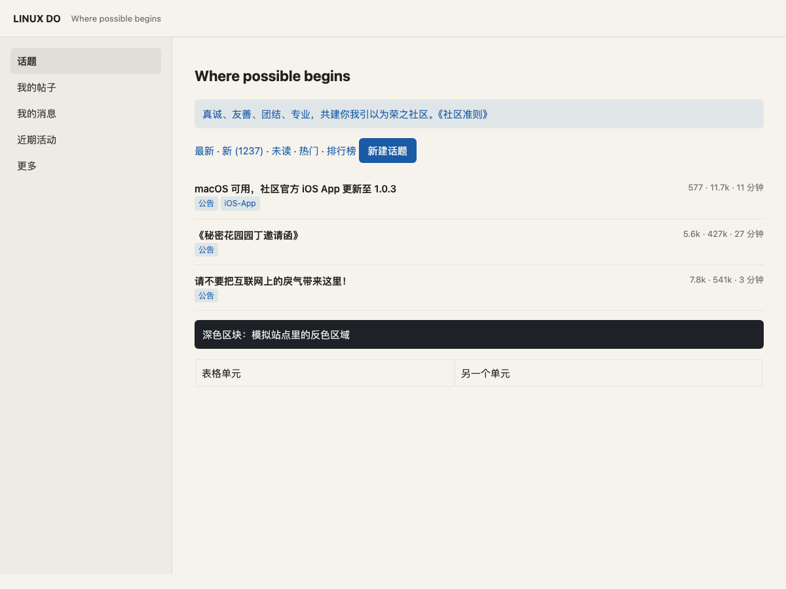

# Warm Rain for the web

A [Tampermonkey](https://www.tampermonkey.net/) userscript that carries the
Warm Rain palette onto ordinary web pages. Part of the
[Warm Rain collection](../README.md), which ships the same palette for Herdr,
VS Code, T3 Code, and Tabby.

## Install

1. Install Tampermonkey (or any userscript manager) in Chrome, Edge, Firefox,
   or Safari.
2. Open [`warmrain.user.js`](warmrain.user.js) and install it, or add its
   contents as a new script in the manager's dashboard.
3. Reload any page. White surfaces become warm paper; colored accents quiet
   down without changing their hue.

To update, open the script in the dashboard, replace its contents, and save.

## What it does

The script adds one fixed, full-viewport layer painted `#f6f3ec` with
`mix-blend-mode: multiply`, and nothing else. Every color already on the page is
multiplied by the Warm Rain canvas:

| Original | Result |
| --- | --- |
| `#ffffff` | `#f6f3ec` |
| `#f7f7f7` | `#eeebe5` |
| `#1f2328` | `#1e2125` |
| `#1a5fb4` | `#195ba7` |

Because it is a multiplicative shift, a surface and its text are scaled
together, so contrast is preserved. Dark themes stay dark (just warmer), and
there is no per-element patching. The fixed layer is composited above iframes
too, so embedded content is tinted along with the rest of the page.

The earlier approach — forcing `body` and input backgrounds and layering
multiply on top — made pages look patchy, because white cards and the forced
body background ended up at different tints. This version touches no page
styles.

## Resilience

The layer is attached to `<html>`, not `<body>`, so sites that replace their
body (Turbo navigation, React roots) do not take it with them. It is applied
before any `GM_*` call, and every `GM_*` call is guarded: a userscript
manager whose background page is still starting can throw at
`document-start`, which used to abort the script before it painted anything.

The wash is re-checked on `DOMContentLoaded`, `load`, `pageshow`,
`turbo:load`, `turbo:render`, and `pjax:end`, and a `MutationObserver` puts it
back if a page removes it.

If the layer is missing entirely on a page, the userscript manager never ran
the script for that document — a known Tampermonkey state after editing
a script while pages are open (it logs `Cannot create item with duplicate id`
for the script's UUID). Reload the page, or toggle the script off and on in
the dashboard to force re-registration. The script cannot fix that from
inside, because it is not executing at all.

## Per-site control

The userscript menu has two entries:

- **⛔ 在此站点禁用 Warm Rain** / **✅ 在此站点启用 Warm Rain** — toggles the
  current host, stored with `GM_setValue`.
- **↺ 重置所有站点的 Warm Rain 设置** — clears the disabled-host list.

Use the disable toggle for image-heavy sites or anywhere the tint gets in the
way.

## Notes

- Images and videos are tinted too, since they sit under the same layer. That
  is what keeps the page uniform; exempting them would reintroduce the
  patchwork.
- The layer is `pointer-events: none` and sits at `z-index: 2147483647`, so it
  changes color only and does not intercept clicks or typing.
- Sites that render the page inside a transformed or filtered root can clip a
  fixed layer; that is a CSS limitation, not something the script can detect.
